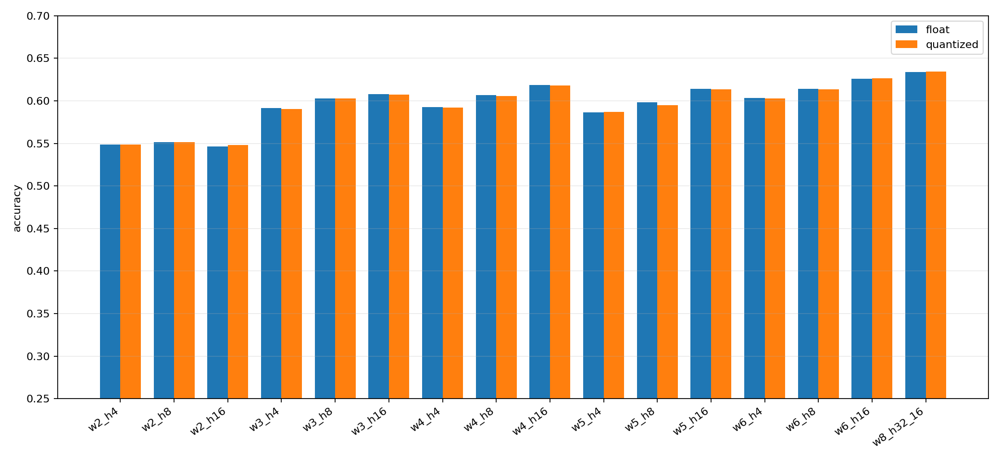

# Обучение модели

Генерация синтетических партий, обучение MLP, квантование весов в `int8` и экспорт на C.

## Результаты

В прошивке используется модель `w6_h16`: история шести раундов, архитектура `36 → 16 → 3`, ReLU. Веса и смещения занимают 643 байта, масштаб квантования — `SCALE = 64`, `SHIFT = 6`.

| Конфигурация | Архитектура | Веса и смещения | Точность int8 |
| --- | --- | --- | --- |
| `w4_h16` | `24 → 16 → 3` | 451 байт | 61,78% |
| `w6_h16` | `36 → 16 → 3` | 643 байта | 62,67% |
| `w8_h32_16` | `48 → 32 → 16 → 3` | 2147 байт | 63,43% |

Точность измерена на синтетической тестовой выборке. Полные результаты 16 конфигураций: [CSV](artifacts/sweep/config_results.csv), [JSON](artifacts/sweep/config_results.json), [сводка размеров](artifacts/sweep/quantized_model_summary.csv).



## Установка

Зависимости: Python, пакеты из [requirements.txt](requirements.txt) и GCC для проверки C-экспорта. В Windows скрипт проверки также поддерживает GCC через WSL.

```powershell
cd training
python -m venv venv
.\venv\Scripts\Activate.ps1
python -m pip install -r requirements.txt
```

В Linux окружение активируется командой `. venv/bin/activate`. В `requirements.txt` указана сборка PyTorch для CUDA 12.8.

## Обучение

Из каталога `training/`:

```sh
python scripts/run_pipeline.py --window 6 --hidden-sizes 16 --epochs 30
```

Pipeline генерирует train/validation/test-выборки, обучает модель, выполняет квантование и сравнивает результат с базовыми стратегиями. Модели и графики сохраняются в `artifacts/`, отчёт — в `docs/results.md`.

Игра против обученной модели:

```sh
python scripts/play_quantized.py --model-path artifacts/model_quantized.npz
```

## Сравнение конфигураций

```sh
python scripts/sweep_configs.py --epochs 100 --early-stop-patience 5 --early-stop-min-delta 0.001
```

Скрипт перебирает окна 2–6 раундов со скрытыми слоями 4, 8 и 16 нейронов, а также модель `w8_h32_16`. Результаты сохраняются в `artifacts/sweep/`, обученные модели — в `artifacts/sweep/work/<конфигурация>/`.

## Экспорт и проверка

После sweep:

```sh
python scripts/export_controller_weights.py --model-path artifacts/sweep/work/w6_h16/model_quantized.npz --output-dir controller
python tests/test_controller_export.py
```

Проверка сравнивает логиты и предсказания Python и C на 12 наборах истории и последовательности ходов. Для неё нужен файл `model_quantized.npz`, создаваемый при обучении.

Для обновления прошивки скопируйте `controller/model_weights.c` и `controller/model_weights.h` в [firmware/neural_network/](../firmware/neural_network/). Реализация инференса находится в `controller/quant_model.c` и `controller/quant_model.h`.
